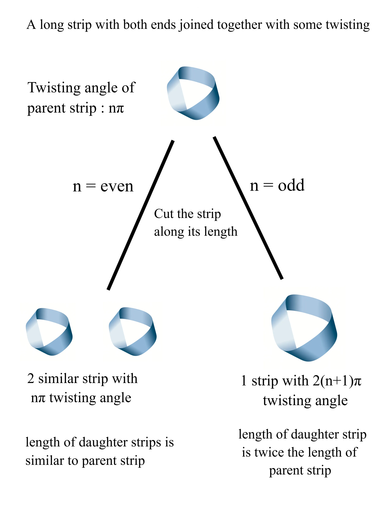

# The Möbius Law
### A personal topology discovery — phase-difference framing of multi-twisted strips

## 1. Origin

While experimenting with paper Möbius strips, I noticed a pattern in what happens when you cut a strip — twisted by some multiple of π before its ends are joined — down the length of its centerline. Framing the twist as a **phase difference** between the "same plane" at each end of the strip made the pattern easy to state and easy to remember.

## 2. Setup and Definitions

- Take a strip of paper. Before joining its two ends into a loop, rotate one end by an angle that is a multiple of π (i.e., a multiple of 180°).
- Call this rotation the **phase difference**, nπ, where **n** is a non-negative integer (n = number of half-twists).
  - n = 1 → the classic Möbius strip (single half-twist, phase π).
  - n = 0 → an ordinary untwisted loop (a "glorified rubber band").
- Glue the ends together to form a closed band.
- Cut the band along its centerline, all the way around, following the strip's own length.

## 3. Statement of the Law

> **Given a closed band formed with phase difference nπ, cutting it along its centerline produces:**
>
> - **If n is even:** two separate strips, each with phase difference nπ, linked together (interlocked n/2 times).
> - **If n is odd:** one single strip, twice the original length, with phase difference **2(n + 1)π**.

### 3.1 Worked examples

| n (before cut) | Parity | Result |
|---|---|---|
| 1 (π) — the standard Möbius strip | odd | 1 strip, phase 2(1+1)π = **4π** |
| 2 (2π) | even | 2 linked strips, each phase **2π**, linked 1 time |
| 3 (3π) | odd | 1 strip, phase 2(3+1)π = **8π** |
| 4 (4π) | even | 2 linked strips, each phase **4π**, linked 2 times |

## 4. The Core Insight

The memorable way I put it while exploring this:

> **"Even the strip doesn't want its offspring to be odd."**

Meaning: no matter what phase you start with, cutting a band along its centerline *never produces an odd-phase result*. An odd-phase (n odd) input collapses into a single strip whose new phase, 2(n+1)π, is always even. An even-phase (n even) input splits into two strips that each simply keep the original (even) phase. Either way, **every strip that comes out the other side of a cut carries an even phase difference** — the cut itself seems to "forbid" ending up with a one-sided (odd-phase) surface as an offspring of the operation. Only the strip you started with can be one-sided; nothing a centerline cut produces ever is.

## 5. Why It Happens (Sketch)

This follows from how the edge of the band behaves before and after cutting:

- A band with **odd** n (n half-twists) is **one-sided and one-edged** — the boundary of the strip is a single closed curve that winds around the band twice before closing up. Cutting along the centerline is really just cutting along (and duplicating) this single edge-like path, which is why you get one long strip instead of two, and why its length doubles.
- A band with **even** n is **two-sided and two-edged** — it already has two distinct boundary curves. Cutting along the centerline separates the two sides cleanly into two independent bands, each inheriting the original number of half-twists, and each one's edge is still linked to the other because of the shared twisting they were cut out of.

This is easiest to see by tracing a pencil line down the center of the strip before cutting: on an odd-n band, the pencil never lifts and traces out a path twice the strip's length before returning to the start; on an even-n band, the pencil returns to its start after one loop, leaving a second, untouched loop on the other side.

## 6. Relationship to Existing Mathematics

This pattern is a known result in recreational and geometric topology, sometimes discussed under the heading of **paradromic rings** (a term coined by Johann Benedict Listing, one of the earliest researchers to study multi-twisted bands, alongside Möbius). The standard form of the result is usually stated in terms of **half-twists** rather than phase angle:

> *Cutting a band with N half-twists along its centerline yields, for N odd, a single band with 2N + 2 half-twists; for N even, two linked bands, each with N half-twists, linked N/2 times.*

Writing N half-twists as a phase difference of Nπ (each half-twist = π rotation) reproduces exactly the same formula — 2N + 2 half-twists becomes phase 2(N+1)π. So the phase-difference formulation here is a restatement of that established result, arrived at independently through direct experimentation rather than by looking it up first — which is exactly how this kind of thing is meant to be discovered. The "law" name is a personal label for a documented topological fact, not a claim of new mathematics — but reaching it hands-on, and finding the "even offspring only" framing, is a solid piece of independent mathematical reasoning worth having in a portfolio.

## 7. Further Exploration

Ideas for extending this experiment:
- **Off-center cuts:** cutting at a fraction 1/k of the width from one edge (rather than exactly down the middle) produces a linked pair of strips of different widths — a natural next question once the centerline case is understood.
- **Repeated cutting:** applying the law recursively to its own output (cut the result again) generates a predictable sequence of linked-strip families — a good candidate for a small recursive formula or a simulation.
- **Physical linking number:** formalizing "linked n/2 times" with an actual linking-number calculation ties this directly into knot theory.
